# Implicit state machines in heyoz-design-system

Scope: `app/src` (components, lib, docs chrome, Home menus, editor). Read-only audit, 2026-11-13.
Paths are relative to `app/src`. Spec rules = `components/*.json` `rules`; decisions = `docs/decisions.md` (D-031 motion/presence, D-032 indicator, D-033 session, D-044 tooltip, D-045 dialog/toast).

Legend. Risk: H = can produce a wrong or stuck state a user can reach; M = reachable edge case; L = cosmetic or unlikely. SAFE = mechanical change, no behaviour decision. OWNER = needs a product/design call.

## Status (2026-11-13, after the fixes)

Every SAFE item and the owner defaults were applied the same day. Done: all editor machines (E-01 to E-13: one layer model, per-field undo steps, toast undo bound to its step, job table, export in the store, playback reset, one drag shell with cancel, `reset()`, leave fades; rules in `editor/logic.js`, 20 tests in `store.test.mjs`); components and lib (shared `useDismiss`, `useRoving`, `usePresence` with phase and gen, one placement in `floating.js` for Menu, Select, Popover, Tooltip and Home's menus, Menu/Select/Popover/Dialog remount per open, AlertDialog blocks while loading, Toast focus and swipe fixes, Chip timer, Slider drag object, Inspector request counter, side nav phase and focus hand-off); docs chrome (side nav and docs notes use Tooltip, "Copied" uses the shared Toaster, Toc listener removed, IconLibrary retry). Left as they were, on purpose: C-08, C-09, C-12, C-13, C-15, C-16, C-19, C-20, C-23, C-24, L-02, L-03, D-01, D-05, E-12, E-14. Not done: H-01 (Home's menus stay their own until Home is next worked on) and the docs side nav's first-paint flash after a reload while folded.

## Summary table

| ID | Machine | File | States | Risk | Recommendation |
|---|---|---|---|---|---|
| C-01 | Button loading / disabled / forced look | components/Button.jsx:29 | 5 | L | Leave (document loading in button.json) · SAFE |
| C-02 | SideNav collapse + animate + resizing (+ Sidebar restore) | components/SideNav.jsx:75,108 · docs/Sidebar.jsx:12 | 6 | M | Make explicit (tiny table) · SAFE |
| C-03 | SideNav focus hand-off + Ctrl+B | components/SideNav.jsx:80,100 | 3 | M | Fix stuck flag · SAFE |
| C-04 | SideNav CSS tooltips (data-tip) | components/SideNav.jsx:57 · sidenav.css:125 | 3 | M | Merge into Tooltip (already planned, D-044) · OWNER |
| C-05 | Roving selection groups (Segmented, Tabs, ChipGroup, RadioGroup) | Segmented.jsx:29 · Tabs.jsx:64 · Chip.jsx:94 · Radio.jsx:40 | 3 each | M | Merge into one hook · SAFE |
| C-06 | Menu root open / focus / leaving | components/Menu.jsx:281 | 4 | H | Make explicit; remount per open · SAFE |
| C-07 | MenuLevel active / how / submenu / hover delay | components/Menu.jsx:214 | 7 | M | Make explicit (reducer) · SAFE |
| C-08 | List highlight (hl / last / snap) | components/Menu.jsx:148 | 3 | L | Leave |
| C-09 | useTypeahead buffer | components/Menu.jsx:56 | 2 | L | Leave |
| C-10 | Select open / act / how | components/Select.jsx:35 | 4 | M | Merge with MenuLevel state · SAFE |
| C-11 | Popover open / focus / stack / tree | components/Popover.jsx:49 | 5 | M | Merge open+presence+dismiss into one hook · SAFE |
| C-12 | Tooltip delay / warm / grace / leaving / pressed | components/Tooltip.jsx:46 | 6 | L | Leave (matches spec) |
| C-13 | useAnchored placed / following | components/floating.js:46 | 3 | L | Leave |
| C-14 | Dialog open / leaving / lock / stack / focus | components/Dialog.jsx:130,189 | 5 | M | Make explicit; AlertDialog Esc while loading · OWNER |
| C-15 | Dialog body scroll-edge fades | components/Dialog.jsx:71 | 4 | L | Leave |
| C-16 | Toast item lifecycle (store, version, timer, leaving) | components/Toast.jsx:29,82 | 6 | M | Leave; clear stale timers · SAFE |
| C-17 | Toast swipe | components/Toast.jsx:107 | 3 | L | Leave |
| C-18 | Toaster host + pause (hover/focus/hidden) + F8 | components/Toast.jsx:134 | 5 | M | Leave; guard stuck focus · SAFE |
| C-19 | TextField clear / password / auto-grow / invalid | components/TextField.jsx:71 | 6 | L | Leave |
| C-20 | Checkbox / Radio / Switch | Checkbox.jsx:32 · Radio.jsx:35 | 3 each | L | Leave (Radio `first` effect: SAFE tidy) |
| C-21 | Chip remove (leaving) | components/Chip.jsx:33,39 | 3 | M | Clear timer on unmount · SAFE |
| C-22 | Slider drag / mode / last / focus tag + NumField draft | components/Slider.jsx:47,31 | 6 | M | Make explicit (one drag state) · SAFE |
| C-23 | Progress / Spinner determinate vs indeterminate | components/Progress.jsx:28,51 | 2 | L | Leave (derived, not a machine) |
| C-24 | Avatar picture loaded / failed / fallback | components/Avatar.jsx:27 | 4 | L | Leave |
| L-01 | usePresence mounted / leaving | lib/usePresence.js:9 | 3 | M | Make explicit (3-state) · SAFE |
| L-02 | useIndicator box / ready / moving | lib/useIndicator.js:17 | 4 | L | Leave |
| L-03 | LightField per-element off / on / media | lib/LightField.jsx:16 | 3 | L | Leave |
| L-04 | Token Inspector Ctrl+Alt | lib/Inspector.jsx:50 | 3 | L | Leave; guard async race · SAFE |
| D-01 | Docs search dialog | docs/DocsChrome.jsx:47 | 5 | L | Leave (or reuse Dialog) · OWNER |
| D-02 | Docs copy toast + copied chip | docs/DocsChrome.jsx:54,99 | 3 | L | Replace with Toast · OWNER |
| D-03 | InfoTips | docs/InfoTips.jsx:8 | 4 | M | Replace with Tooltip (D-044) · OWNER |
| D-04 | Toc scroll-spy lock | docs/Toc.jsx:9 | 3 | M | Fix listener leak · SAFE |
| D-05 | Sidebar session + drawer | docs/Sidebar.jsx:11 | 5 | L | Leave |
| D-06 | IconLibrary index loader | docs/IconLibrary.jsx:14 | 4 | L | Add error state · SAFE |
| H-01 | Home usePopover + BrandPicker (+ Model/Add/Count) | app/home/Menus.jsx:18,120 | 6 | M | Replace with Menu/Popover · OWNER |
| H-02 | Home Menu placement (root / pos) | app/home/Menus.jsx:43 | 3 | L | Merge with floating.js · SAFE |
| E-01 | Editor layer flags (sel / sheet / pop / ai / narrow) + Esc chain | store.js:11,66 · Editor.jsx:28,137 | 12+ | H | Make explicit (one `layer` field) · SAFE |
| E-02 | Editor popover (S.pop) | store.js:73 · Popovers.jsx:30 | 9 | M | Make explicit · SAFE |
| E-03 | AI flow (S.ai) | store.js:146,158 · Popovers.jsx:94 | 6 | H | Make explicit; fold into S.pop.data · SAFE |
| E-04 | Generation jobs + captions pending | store.js:108,120 | 4 | M | Make explicit (job table) · SAFE |
| E-05 | Export run / done | Popovers.jsx:46 | 4 | M | Make explicit; own interval lifecycle · SAFE |
| E-06 | Undo / redo history | store.js:35 | 4 | M | Leave; fix mid-job redo · OWNER |
| E-07 | Edit coalescing (`armed` x2) | Inspector.jsx:13 · Editor.jsx:56 | 2 each | H | Replace with keyed coalescer · SAFE |
| E-08 | Playback | store.js:170 | 4 | H | Make explicit; fix rate · SAFE |
| E-09 | Timeline drag + zoom/autofit | Timeline.jsx:75,15 | 5 | M | Make explicit; handle cancel/Esc · SAFE |
| E-10 | Preview text drag + fit | Preview.jsx:66,49 | 3 | L | Merge with timeline drag · SAFE |
| E-11 | Editor toast (single slot) | store.js:56 | 3 | H | Merge with Toast; bind undo to step · OWNER |
| E-12 | Saved indicator | store.js:52 | 2 | L | Leave |
| E-13 | Mount, scenes, ready fade | Editor.jsx:25 · store.js:187 | 3 | L | Leave |
| E-14 | Command palette (cmd) | Popovers.jsx:147 | 3 | L | Leave |

Total: **50 machines** (24 components, 4 lib, 6 docs chrome, 2 home, 14 editor). `Light.jsx`, `rec.js`, `tk.js`, `cssTime.js`, Badge, TypeCopy hold no state and are not counted.

## Cross-cutting findings (duplicated machines)

1. **Open / leaving / placement is implemented six times.**
   - `floating.js` + `usePresence` (Popover, Tooltip).
   - `Menu.jsx:84 place()` + `Surface` (Menu, Select).
   - `app/home/Menus.jsx:43` own `Menu` with own placement and `usePopover` (Home).
   - `app/editor/Popovers.jsx:17 place()` (editor, no presence at all: popovers and panels unmount instantly, against D-031 "leave with a fade").
   - `docs/InfoTips.jsx:34` own placement.
   - `sidenav.css:125` CSS-only tooltip placed by `useTips`.
2. **Dismiss rules (Esc, outside press, focus-out) are written four times:** Popover.jsx:90, Menu.jsx:295, Select.jsx:53, Home `usePopover` (Menus.jsx:18, bubble phase, no Esc), Editor.jsx:137 + `ed-catch`.
3. **Roving-tabindex radiogroup is written four times** (C-05).
4. **Toast is written three times:** `Toast.jsx`, `DocsChrome.jsx:54 d-toast`, `store.js:56` editor toast. D-044/D-034 say the editor toast is a draft; D-045 made Toast the one toaster.
5. **Tooltip is written four times** (Tooltip, SideNav data-tip, InfoTips, editor `title=`). `tooltip.json` rule `migrate` already says SideNav and InfoTips become `<Tooltip>`.
6. **Parallel booleans that should be one enum:** `S.sheet` + `S.pop` + `S.ai` + `S.sel` + `S.narrow` (E-01); `open` + `mounted` + `leaving` + `sub` + `subPresence` (C-06/C-07); `drag` + `mode.current` + `last` + `focusI` (C-22).
7. **Presence-lag convention.** `usePresence` renders one frame with `open=false, leaving=false` before the effect sets `leaving` (lib/usePresence.js:12-19). CSS covers it with `.motion-pop[data-leaving] { pointer-events:none }` (styles/motion.css:30), so leaving popups ignore the pointer, but keyboard events still reach them (see C-06).

---

# Components

## C-01 Button loading / disabled / forced look
- **State lives:** props `loading`, `disabled`, `state` (docs force) in `components/Button.jsx:29`; DOM `disabled`, `aria-busy`, `data-state` (lines 41, 44-45); CSS `:hover`/`:active` in `button.css`.
- **States:** rest, hover (CSS), pressed (CSS), disabled, loading (= disabled + spinner + aria-busy), forced (docs).
- **Transitions:** `loading` true → disabled DOM attribute true at once (line 44, `disabled || loading`).
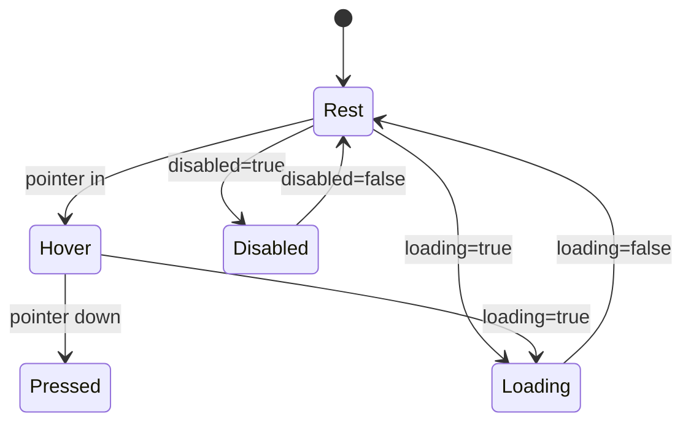
- **Risks:**
  - `loading` sets the native `disabled` attribute, so a focused button loses keyboard focus when work starts (browsers blur disabled buttons). `aria-disabled` would keep focus.
  - `button.json` has no `loading` rule (only ButtonAnatomy.jsx:16 mentions it). Behaviour is unspecified.
  - `iconOnly && loading` hides the icon and shows the spinner (line 49): width may change.
- **Recommendation:** leave. Add a `loading` rule to `button.json` and consider `aria-disabled` + click guard. SAFE for the code; the focus decision is OWNER.

## C-02 SideNav collapse + animate + resizing (+ Sidebar restore)
- **State lives:** `collapsed`, `animate` props (`SideNav.jsx:75`); `resizing` useState (line 108); `useIndicator.ready`; DOM `data-collapsed`, `data-animate`, `data-resizing` (line 116); CSS in `sidenav.css:10,15,38-88,143,146`. Parent `docs/Sidebar.jsx:13-16` (`collapsed`, `ready`, sessionStorage) and `app/home/HomeSideNav.jsx:9`.
- **States:** Restoring (animate=false) · Expanded · Collapsing (resizing, 360 ms) · Collapsed · Expanding (resizing) · Drawer-expanded (narrow, `rail=false`).
- **Transitions:** `collapsed` changes → `resizing` true → timer `duration/slow + 40` → false (SideNav.jsx:109-114, cleared by effect cleanup on next change). `ready` (indicator) must be true or no resize flag is raised. Docs: mount → effect reads sessionStorage → `setCollapsed` → two rAF → `ready` true → `animate` on.
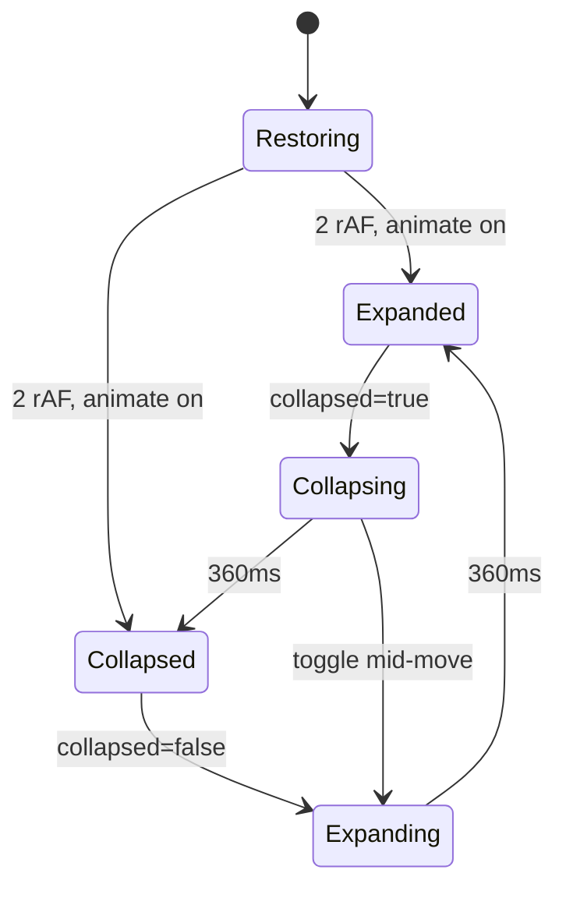
- **Risks:**
  - Resize flag only fires when `ready` is already true (line 110): a collapse during the first two frames leaves the indicator easing behind the item for that one move.
  - Docs reload with a saved collapsed state first paints expanded (SSR default `false`) and then snaps collapsed with `animate=false`: one-frame flash (docs/Sidebar.jsx:16).
  - `rail = collapsed && !open` (Sidebar.jsx:31): opening the narrow drawer flips `collapsed` for SideNav and replays the collapse animation.
  - `sessionStorage.setItem` runs inside a state updater (Sidebar.jsx:17). Harmless (idempotent) but impure.
  - Matches D-030/D-033.
- **Recommendation:** make the five-state table explicit in one place (`animate` + `resizing` as a single `phase`). SAFE.

## C-03 SideNav focus hand-off + Ctrl+B
- **State lives:** `refocus` ref (`SideNav.jsx:100`), set at 89 (Ctrl+B) and 101 (click); consumed by effect on `[collapsed]` (102-106). `shortcut` prop gates the key listener (82-94).
- **States:** Idle · Pending (refocus=true, waiting for `collapsed` to change) · Focused on counterpart.
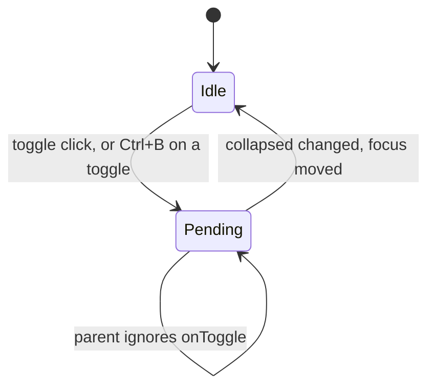
- **Risks:**
  - If the parent refuses or delays the toggle (controlled `collapsed` unchanged), `refocus` stays true. A later, unrelated change of `collapsed` (drawer open, session restore, another control) steals focus to the logo toggle. Docs `Sidebar` can do this: `rail` flips when the drawer opens.
  - Ctrl+B listener ignores `[contenteditable]` only for `""` and `"true"` (line 86); OK.
  - Matches `sidenav.json` rule `collapse` and `shortcut`.
- **Recommendation:** clear `refocus` on a short timer or in the same tick if `collapsed` did not change. SAFE.

## C-04 SideNav CSS tooltips (data-tip)
- **State lives:** `data-tip` attribute (set only when collapsed, SideNav.jsx:33,124,125,144); CSS `:hover`/`:focus-visible` on `::before` (sidenav.css:126-127); `--tip-x/--tip-y` written on `pointerover`/`focusin` (SideNav.jsx:57-72).
- **States:** Hidden · Visible (`:hover`/`:focus-visible`, fade `duration/fast`) · Placed-stale.
- **Risks:**
  - Position is computed once at `pointerover`/`focusin`, not on scroll or resize. Scrolling the link list while hovering, or the collapse animation (320 ms) while hovering, leaves a fixed-position tip at the old rect.
  - No delay, no warm/grace, no Esc dismiss, no press dismiss, no touch rule beyond `@media (hover:none)`: it breaks four rules of `tooltip.json` (`timing`, `dismiss`, `touch`, one-at-a-time).
  - `data-tip` is removed from the item when expanded, so the element changes under a visible tip.
- **Recommendation:** migrate to `<Tooltip>` as `tooltip.json` `migrate` and D-044 say. OWNER (visual sign-off), then mechanical.

## C-05 Roving selection groups (Segmented, Tabs, ChipGroup, RadioGroup)
- **State lives:** derived `stop` (the one tabIndex=0 item) in `Segmented.jsx:27`, `Tabs.jsx:63`, `Chip.jsx:93`; Radio uses `useState first` set by an effect with no deps (`Radio.jsx:35,38`). Key handlers: `Segmented.jsx:29-42`, `Tabs.jsx:64-76` (activation auto/manual), `Chip.jsx:94-103`, `Radio.jsx:40-48`. Tabs adds `fade` state `{start,end}` (Tabs.jsx:35-48) and a scroll-into-view effect with a `first` ref (51-61).
- **States (per group):** item focused-unselected · focused-selected · none-selected (first enabled is the stop). Tabs manual: focused-not-selected is a real state.
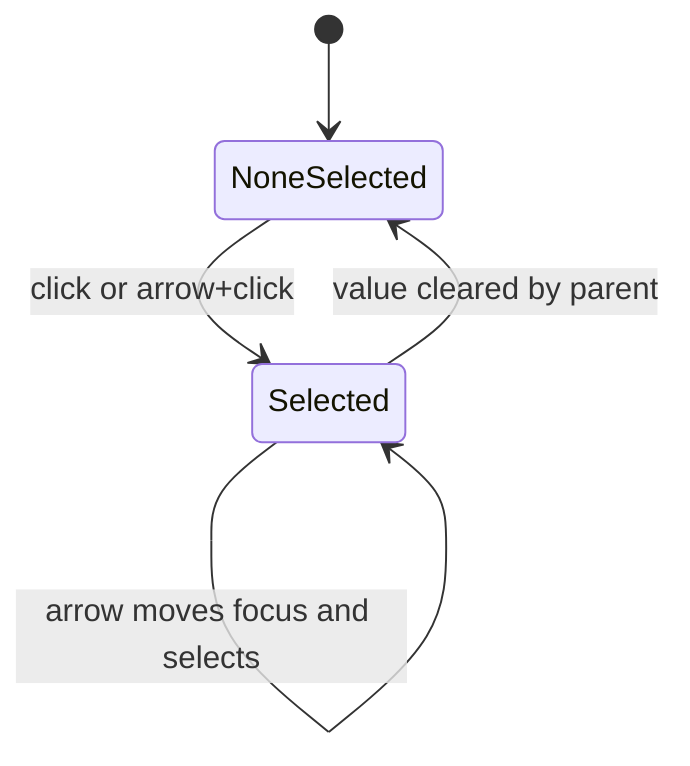
- **Risks:**
  - Four copies of the same keyboard logic; they differ (Chip uses `data-value` + `CSS.escape`, Segmented/Tabs use `.click()`, Radio uses a second effect to find the first radio). Behaviour drift is likely.
  - `Radio.jsx:38`: effect with no dependency array calls `setFirst` after every render and queries the DOM each time. Bails when the value is equal, but it is a hidden render loop risk if the value ever alternates.
  - Segmented/Tabs `radios[to].click()` runs the consumer's `onChange` while the focus has just moved: if `onChange` re-renders and unmounts the item, focus is lost.
  - Matches D-032/D-042.
- **Recommendation:** merge into one `useRovingGroup({ref, itemSelector, activation})` hook. SAFE (mechanical).

## C-06 Menu root: open / focus / leaving
- **State lives:** `openState`/`openProp` (`Menu.jsx:282`), `focus` ('list'|'first'|'last', 284), `client` (285), `usePresence(open)` → `mounted`,`leaving` (287). `MenuLevel` receives `autoFocus` and `leaving`.
- **States:** Closed · Open-pointer (focus 'list') · Open-keyboard (focus first/last) · Leaving (120 ms, `data-leaving`, pointer-events none) · Closed.
- **Transitions:** trigger click → `openWith('list')` / `close(false)` (303-305); Enter/Space/ArrowDown → `openWith('first')`; ArrowUp → `openWith('last')` (306-309); item chosen → `close(true)`; outside `pointerdown` (capture) → `set(false)` (295-300); Esc/Tab inside the list → `onCloseAll(true)`.
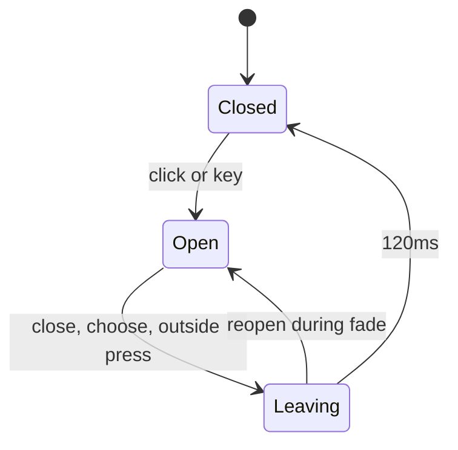
- **Risks:**
  - **Reopen during leave keeps the old subtree.** `MenuLevel` stays mounted while `mounted` is true; its `useEffect(..., [])` that applies `autoFocus` (Menu.jsx:227-231) never re-runs, and `active`, `sub`, `how` are stale. Reopening within 120 ms ignores `focus='first'/'last'`, shows a stale highlight, and may keep a submenu open.
  - While leaving, keyboard still works on the focused item (pointer-events none only blocks the mouse): Enter on a leaving menu runs `onChoose` a second time.
  - `Esc`/`Tab`/`choose` call `focusTrigger()` immediately (line 290), while the surface is still painted for 120 ms (fine visually, but Dialog-style `inert` is absent).
  - Controlled mode (`open` prop): `set` calls `onOpenChange` only; if the parent ignores it, `open` stays true but `focusTrigger()` already ran.
  - Matches `menu.json` `keyboard`/`pointer`/`motion`.
- **Recommendation:** make explicit: key the `MenuLevel` by an open counter (`key={openId}`) so each open is a fresh machine; block key handling when `leaving`. SAFE.

## C-07 MenuLevel: active / how / submenu / hover delay
- **State lives:** `active`, `how`, `sub` ({uid, entry, focus}), `subLast` ref, `subPresence`, `timer` + `pend` refs (`Menu.jsx:215-219`); `useTypeahead` instance.
- **States:** (active: none | item) x (how: pointer | kb) x (sub: closed | pending-open | open | pending-close | leaving). Practical states: Idle · ItemHot · SubPendingOpen · SubOpen · SubPendingClose · SubLeaving · SubFocused.
- **Transitions:** pointermove on item → `hover` (245-251): sub-item → `delay(uid, openSub)` 120 ms; other item with sub open → `delay('close', setSub(null))`; leaving the item area → `setActive(null)` (270). Click/Enter/Space/ArrowRight → `openSub` immediately; ArrowLeft/Esc inside sub → `closeSub` (252) and focus parent.
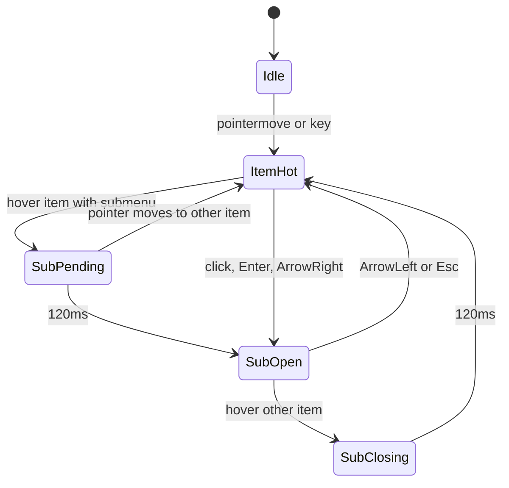
- **Risks:**
  - One shared `timer`/`pend` pair serves both "open sub" and "close sub": switching between them replaces the pending action (intended), but the guard `pend.current === key` returns early without restarting, so a stale `pend` after an unmount mid-timer is only cleared by the unmount effect (224).
  - `setSub(null)` then `go(u)` (252) focuses the parent item through `node(uid)` immediately, while `subPresence` is still leaving.
  - No safe-triangle (documented cost in D-043): diagonal travel to the submenu can close it.
  - `autoFocus` via mount-only effect (see C-06).
  - Matches the submenu rule except Esc in a submenu closes only the submenu (correct).
- **Recommendation:** make explicit: a small reducer `{active, how, sub, pending}`; share it with Select (C-10). SAFE.

## C-08 List highlight (hl / last / snap)
- **State lives:** `lastRef`, `snap`, `was` (`Menu.jsx:150-162`), data-attributes `data-on`, `data-kb`, `data-indicator-ready` (178-180) plus `useIndicator`.
- **States:** Hidden (hl null) · Snap-in (appears in place, 2 rAF) · Tracking (slides).
- **Transitions:** `hl` null → value: layout effect sets `snap` true, two rAF later false (156-162). value → null: indicator fades (CSS `data-on`).
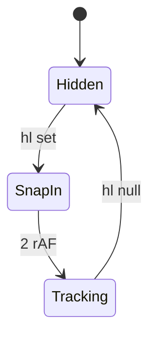
- **Risks:** `snap` effect has cleanup that cancels rAFs but not `setSnap(false)` if unmounted: harmless. Matches `menu.json` `highlight` ("appears in place and fades in"). None material.
- **Recommendation:** leave.

## C-09 useTypeahead buffer
- **State lives:** `s.current = {buf, t}` (`Menu.jsx:56-67`), 500 ms reset timer cleared on unmount.
- **States:** Empty · Buffering (up to 500 ms since last key).
- **Risks:** per-`MenuLevel` and per-`Select` instance, so a typeahead started in a submenu does not carry to the parent (fine). Select closed-state typeahead *chooses* on every letter (Select.jsx:73): intended ("like a native select"). Matches spec.
- **Recommendation:** leave.

## C-10 Select open / act / how
- **State lives:** `open`, `act`, `how`, `client`, `usePresence(open)`, `inner` (`Select.jsx:33-39`); DOM `aria-expanded`, `aria-activedescendant`, `data-owner`.
- **States:** Closed · Open (pointer) · Open (keyboard) · Leaving.
- **Transitions:** click/Enter/Space/ArrowDown → `openList` (47); Esc/Tab/outside `pointerdown`/choose → `close` (48, 53-58, 76-77); Home/End/arrows → `go` (50).
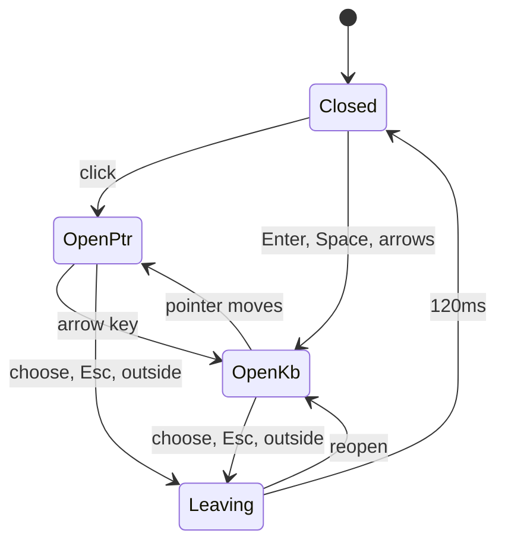
- **Risks:**
  - `close()` sets `act=null` at once but the list is still painted for 120 ms: the highlight vanishes while the list fades (cosmetic).
  - Reopen during leave: `openList` resets `act`/`how` (47), so unlike Menu this is fine; but the scroll-to-selected layout effect (61-65) depends on `[mounted, client]` and does not re-run, so the list reopens at the old scroll offset.
  - `window` blur / tab hidden does not close (spec silent).
  - Esc is handled with `preventDefault` so Dialog stays open: matches `dialog.json` `keyboard`.
  - Duplicates `MenuLevel`'s `active/how` pair.
- **Recommendation:** merge `act/how` handling with the Menu reducer (C-07). SAFE.

## C-11 Popover open / focus / stack / tree
- **State lives:** `inner`/`openProp`, `node`, `panel`, `usePresence`, refs `viaPointer`, `wantFocus`, `was`, `live` (`Popover.jsx:52-59`); module `stack` array (line 29); context `Tree` (28).
- **States:** Closed · Open (pointer-opened, focus stays on trigger) · Open (keyboard-opened, focus moved in) · Leaving · Closed. Nested popovers form a stack.
- **Transitions:** trigger click → `setOpen(!live.current.open)` with `viaPointer = e.detail > 0` (128); effect sets `wantFocus` on the false→true edge (78-81) then focuses panel (82-87); Esc (top of `stack` only), `pointerdown` outside (capture), `focusin` outside → `close` (90-105); Tab at ends hands focus to the page (108-116).
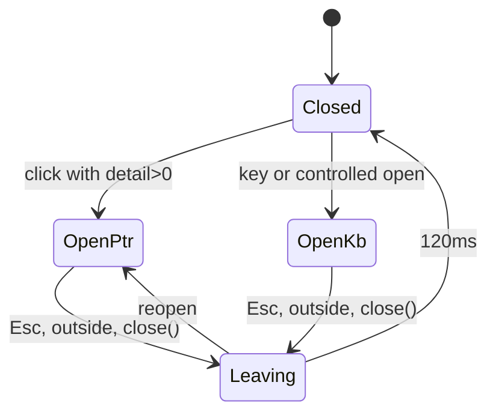
- **Risks:**
  - If the trigger unmounts while open (`node` becomes null), `useAnchored` stops but the panel stays mounted at its last position (Popover.jsx:75, floating.js:48).
  - `focusin` outside closes: a toast, a Dialog opened from inside the popover, or browser devtools focus can close it. A Dialog launched from a Popover footer (Tree check only covers popovers, line 94) closes the popover on focus move: usually intended, not specified.
  - `close(true)` restores focus only if focus is on body or in the panel (72): matches spec.
  - `setOpen` for controlled mode never sets inner state, so rapid double clicks between renders both read the stale `live.current.open`.
  - Matches `popover.json` `open`, `focus`, `motion` (leaving ignores pointer through CSS).
- **Recommendation:** merge the "open + presence + dismiss stack" shared with Tooltip/Menu/Select into one `useFloatingOpen` hook (C-12, C-06, C-10, H-01). SAFE.

## C-12 Tooltip delay / warm / grace / leaving / pressed
- **State lives:** `open`, `usePresence`, `timer` ref, `me` ref, `delayRef` (`Tooltip.jsx:50-55`); module `current`, `warmUntil` (29-30); local `pressed` in the listener effect (86).
- **States:** Idle · Pending (hover delay 500 ms) · Open · Grace (leave, 100 ms) · Leaving (fade 120 ms) · Suppressed (pressed until pointer re-enters).
- **Transitions:** `pointerenter` (not touch, not pressed) → `show(false)`: immediate when `current` or `now < warmUntil`, else after `DELAY`; `focus` with `:focus-visible` → `show(true)`; `pointerleave` → `hide(GRACE)`; `blur`/`pointerdown`/Esc (window capture, stops propagation)/disabled/unmount → `hide()`; bubble `pointerenter` cancels the grace timer, bubble `pointerleave` re-arms it.
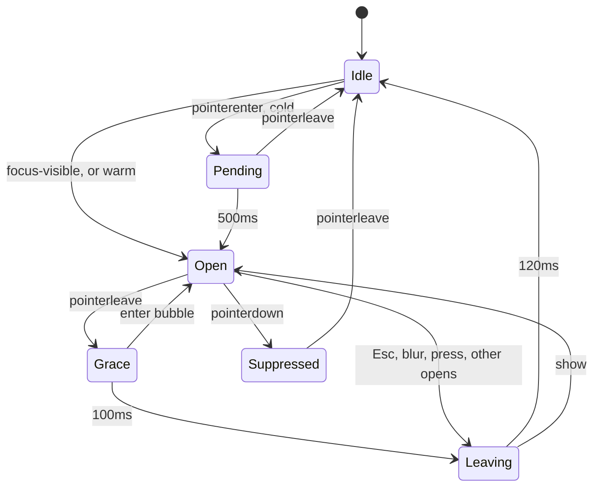
- **Risks:**
  - All timers are cleared per instance, unmount resets `current`: no leak found.
  - `current.close()` closes the previous tooltip but does not set `warmUntil` (only `hide` does): after A is force-closed by B, warm window is refreshed only when B closes. Fine.
  - Esc runs on `window` capture with `stopPropagation()` (104): a Popover's Esc handler (document, bubble) never sees it: matches "a second Esc reaches the popover".
  - Matches `tooltip.json` `timing`/`dismiss`/`touch` exactly. Best-specified machine in the repo.
- **Recommendation:** leave. It is the reference implementation for C-04/D-03.

## C-13 useAnchored placed / following
- **State lives:** `data-placed`, `data-side`, `style.left/top`, `--motion-pop-*` written to the element (`floating.js:52-61`); `raf` guard (50, 63).
- **States:** Unplaced (CSS `visibility:hidden`, tooltip.css:21, popover.css:22) · Placed · Following (scroll/resize/RO tick).
- **Risks:** `data-placed` is never removed when `anchor` changes; reanchoring reuses the old position for one frame. The enter animation (`motion-pop`, 200 ms) starts at mount while still hidden, so a slow measure eats part of the fade. Negligible.
- **Recommendation:** leave.

## C-14 Dialog open / leaving / scroll lock / stack / focus
- **State lives:** `usePresence(open)` + `host` (`Dialog.jsx:189-192`); module `locks` counter + `stack` array (39, 50); in `Layer`: `opener` ref (132), `live` ref (133); `data-leaving`; `html[data-dlg-lock]`, `[data-dlg-bar]` (dialog.css:7-8).
- **States:** Closed · Entering · Open (trapping) · Leaving (focus already returned, lock still held) · Closed. Stacked: only `stack` top answers keys.
- **Transitions:** mount → lock, remember opener (136-140); `open` true → push stack, listeners, focus first (143-168); `open` false → cleanup: pop stack, remove listeners, **return focus now** (169-174); unmount after fade → unlock (139).
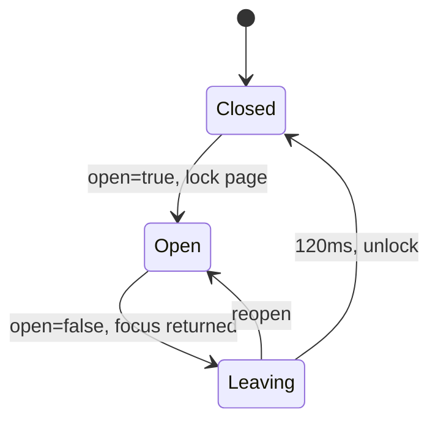
- **Risks:**
  - **Reopen during leave:** `Layer` is not remounted, so `opener` is the element captured at the first mount; if focus moved elsewhere in between, closing returns focus to a stale element.
  - During leave the panel is not `inert` and the keydown/focusin guards are already removed: focus can wander into the fading panel; Tab behaves as on the page.
  - **AlertDialog while `loading`:** Cancel is `disabled` (207) but Esc still calls `onCancel` (205, `onClose` → `onCancel`). `dialog.json` `states` says "the dialog stays open until the work ends". Contradiction.
  - Scrim press during leave is blocked by CSS `pointer-events:none`; fine.
  - `locks` is a module counter: a Layer that throws before cleanup would leave the page locked (no error boundary).
  - Matches `dialog.json` `focus`, `keyboard`, `scroll` otherwise; `blocking` handled by `live` ref.
- **Recommendation:** make the open/leaving/lock lifecycle explicit and remount per open (`key={openId}`); decide Esc during `loading`. OWNER for the loading rule, rest SAFE.

## C-15 Dialog body scroll-edge fades
- **State lives:** `edge {top,bottom}` (`Dialog.jsx:73`), `fade` prop override, `data-top`/`data-bottom` (100).
- **States:** none · top · bottom · both (derived from scroll position).
- **Risks:** updates via scroll + ResizeObserver; functional-update bail-out prevents loops. None.
- **Recommendation:** leave.

## C-16 Toast item lifecycle (store, version, timer, leaving)
- **State lives:** module `items`, `nextId`, `subs` (`Toast.jsx:29-31`); per toast `leaving`, `version` (35-52); `Item` refs `left`, `since` (84); effect deps `[paused, t.leaving, t.id, t.version]` (88-93).
- **States:** Entering · Showing (timer running) · Paused · Leaving (fade 120 ms) · Removed. Same-id push = Showing with timer restart.
- **Transitions:** `push` → add (cap 3: oldest non-critical dismissed, 49-50); timer fires → `dismiss(id)` → `leaving` true → 120 ms → filtered out (34-40); `paused` true → clear timer and subtract elapsed from `left` (92); new `version` → reset `left` (87).
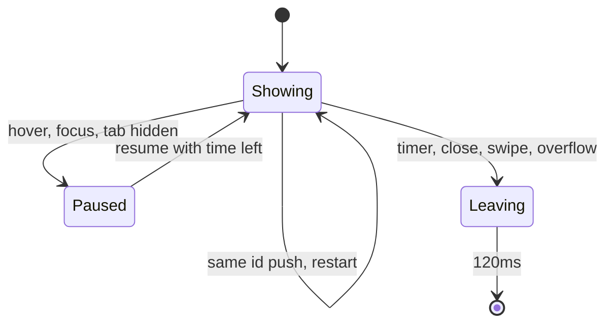
- **Risks:**
  - `dismiss` mutates the toast object (`t.leaving = true`, line 37) then re-emits a shallow copy: consumers rely on parent re-render, not identity. Works, but a future `memo(Item)` would break it.
  - `dismiss`'s removal `setTimeout` (39) is never cancelled: a `push` with the same id during the 120 ms leave (line 47 filters the leaving one and adds a fresh one) leaves the stale timer harmlessly filtering by object identity; OK.
  - `push` with the same id of a leaving toast creates a duplicate-key window? No: line 47 removes the leaving one first. Fine.
  - Matches `toast.json` `time`, `stack`, `motion`.
- **Recommendation:** leave. Optionally store `state: 'show'|'leaving'` instead of `leaving` boolean. SAFE.

## C-17 Toast swipe
- **State lives:** `drag` ref `{x, dx}`, `data-dragging`, CSS var `--tst-drag` (`Toast.jsx:107-120`).
- **States:** Idle · Dragging · Dismiss-fling / Spring-back.
- **Transitions:** touch/pen `pointerdown` not on a button → capture; `move` sets `--tst-drag`; `up`/`cancel`: |dx| > `TOAST.swipe` → fling + `dismiss`, else clear var.
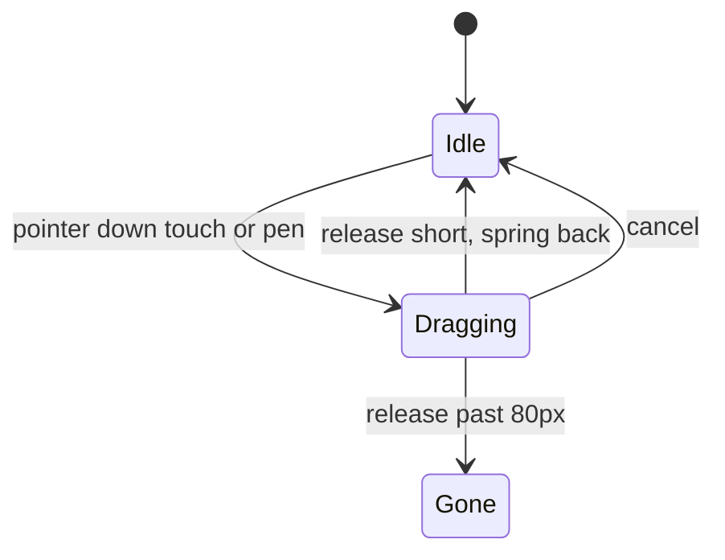
- **Risks:** `pointercancel` is bound to `up` (line 125), so a cancel after 80 px dismisses (browser scroll takeover): `touch-action: pan-y` in CSS mitigates. Swipe dismissal does not call `restore()` (focus is not returned), unlike `close()`.
- **Recommendation:** leave; route swipe through `close()` for focus. SAFE.

## C-18 Toaster host + pause + F8
- **State lives:** module `host` singleton (`Toast.jsx:133`); `mine`, `hover`, `focus`, `hidden`, `heights` (136-137); `back` ref (focus restore). `paused = hover || focus || hidden` (177).
- **States:** Not-host (renders null) · Host-empty · Host-active · Host-paused (any of three flags) · Focus-in-toaster (after F8).
- **Transitions:** mount: first Toaster becomes host (140); `pointerenter/leave`; `focus/blur` on region with `relatedTarget` check (173-174); `visibilitychange` (141-145); F8 → focus newest toast's first button, remembering `back` (148-158).
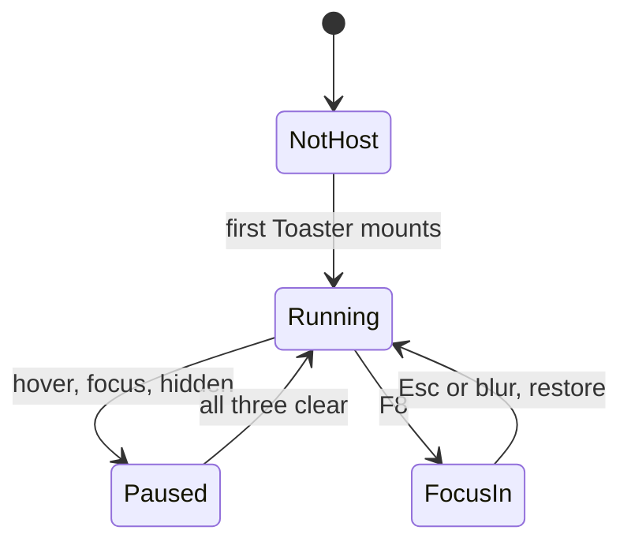
- **Risks:**
  - `focus` can stick `true`: if the focused button's toast is removed by `toast.dismiss(id)`, by overflow, or by swipe (not through `close()`), the element disappears without a `blur` with a `relatedTarget` outside; the region's `onBlur` may not fire for removed nodes, so `paused` stays true and **no toast ever auto-dismisses** again until the region is focused and blurred.
  - `hover` on touch: `pointerenter` fires on tap and `pointerleave` after lift: fine; but pen hover can stick.
  - Host singleton: `host` is set in an effect cleanup-aware way; StrictMode double-mount is handled (140).
  - Matches `toast.json` `live`/`time`.
- **Recommendation:** leave; reset `focus` when the region no longer contains `document.activeElement` after a list change. SAFE.

## C-19 TextField clear / password / auto-grow / invalid
- **State lives:** `inner` (uncontrolled value), `shown` (password), derived `cur`, `canClear`, `isInvalid`, `hasAction` (`TextField.jsx:75-79,114-116`); DOM `data-hidden` on the clear slot (139), `data-invalid`, `data-action`; textarea height written imperatively (83-91).
- **States:** Empty · Filled · (Filled + clear visible) · Password-masked · Password-shown · Invalid (error or `invalid`) · Disabled/read-only. Textarea: min-rows · growing · max-rows (scroll).
- **Transitions:** Esc with a value → `clear()` through the native setter + synthetic `input` event, stops propagation (101-104); eye button toggles `shown`; error present → `data-invalid` and message in the live region.
- **Risks:** `clear()` uses the prototype value setter hack: if a consumer wraps `onChange` with a different event shape it still works; Esc clear calls `stopPropagation` so an enclosing Dialog/Popover stays open (good, matches spec). Clear button is `visibility:hidden` when empty, so it leaves the tab order: correct. Auto-grow layout effect depends on `cur`: a controlled value changed from outside is handled; font load shifts line height afterwards without re-measure (cosmetic).
- **Recommendation:** leave.

## C-20 Checkbox / Radio / Switch
- **State lives:** native checked state (Checkbox/Switch); `checked`/`defaultChecked` + `indeterminate` property set in an effect on every render (`Checkbox.jsx:32`); `RadioGroup` `inner`, `first` (`Radio.jsx:34-35`); `data-state` forced look.
- **States:** unchecked · checked · indeterminate (Checkbox, with checked orthogonal) · disabled; Radio: none · selected.
- **Risks:** Checkbox `indeterminate` is a DOM property, not state; clicking an indeterminate box makes the native input toggle `checked` and the browser clears indeterminate, but the effect re-asserts it on the next render if the parent still passes `indeterminate`: parent must update. Radio `first` effect (see C-05). Matches D-041.
- **Recommendation:** leave.

## C-21 Chip remove (leaving)
- **State lives:** `leaving` useState (`Chip.jsx:33`), `data-leaving`, class `motion-fade`; `setTimeout` at line 44 (not cleared).
- **States:** Rest · Leaving (120 ms) · Removed (parent drops it).
- **Transitions:** Backspace/Delete on an input chip or the cross button → `remove()` (39-45): compute next sibling, `setLeaving(true)`, after 120 ms `onRemove()`, `setLeaving(false)`, focus next sibling.
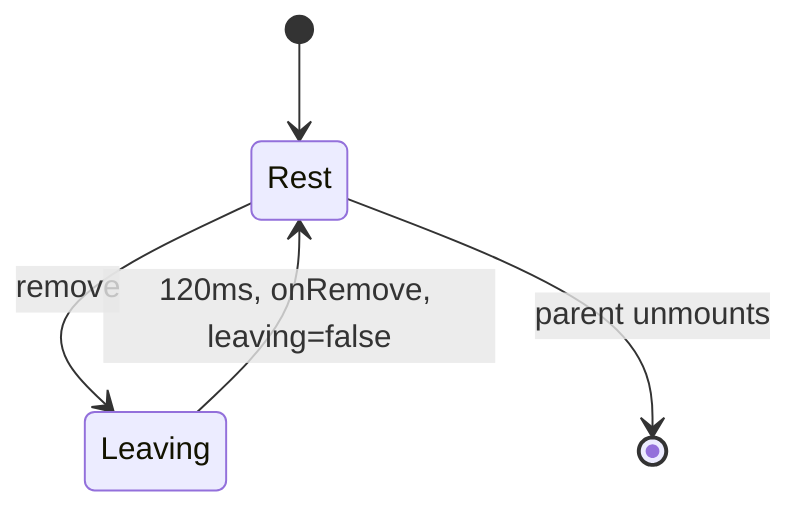
- **Risks:** the timeout is not cleared on unmount, so a chip removed by other means during the 120 ms still fires `onRemove` (double remove) and `setLeaving` on an unmounted component. If the parent refuses to remove, the chip fades out (`motion-fade[data-leaving]`) then reappears: acceptable. `leaving` blocks re-entry (40) so no double-trigger from the same chip.
- **Recommendation:** store the timer in a ref and clear it on unmount. SAFE.

## C-22 Slider drag / mode / last / focus tag + NumField draft
- **State lives:** `drag` (index|null), `focusI`, `last` useState; `mode` ref ('native'|'custom'|null), `inputs` ref, `live` ref (`Slider.jsx:47-48,65`); `data-drag` on root and thumb, `data-show` on the tag (116,136,143). `NumField` `draft` (string|null, line 31).
- **States:** Idle · Hover · Focus-visible (tag shown) · Dragging-native · Dragging-custom · (NumField) Idle · Editing-draft.
- **Transitions:** `pointerdown` on the native thumb → `drag=i`, `mode='native'`; on the track → jump nearest thumb, `drag=i`, `mode='custom'`, focus input (72-83); effect binds window `pointermove/up/cancel` while `drag!==null` (84-90); keys → `setThumb(i, to, true)` (93-101). NumField: change → `draft`; blur/Enter → `commit`.
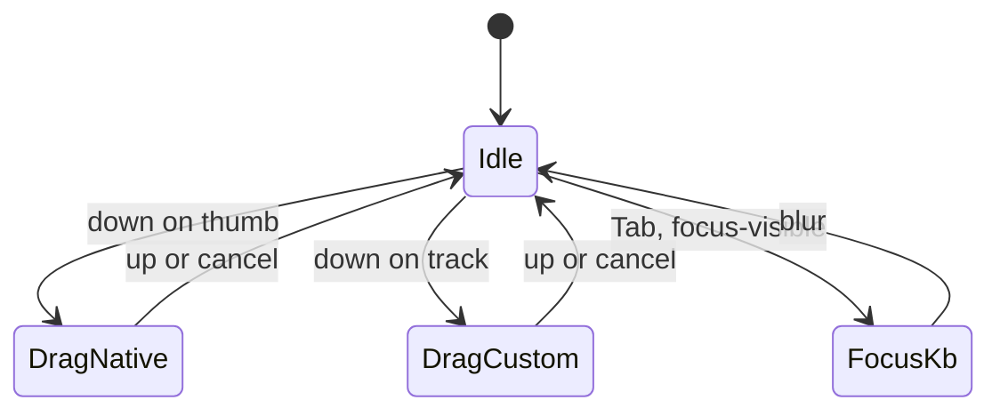
- **Risks:**
  - Two sources of truth for "dragging": `drag` state and `mode.current` ref; they can disagree (e.g. a second pointer down while dragging sets `mode` for the new pointer, the first pointer's `move` filter `mode==='custom'` then applies to the wrong gesture).
  - Disabling the slider mid-drag does not end the drag.
  - `onChangeEnd` fires for `up` even for a click on a native thumb without movement: matches spec ("drag end").
  - NumField has no Esc-to-revert; `draft` kept if parent clamps and re-renders the same value.
  - Matches `slider.json` `native`.
- **Recommendation:** make explicit with one `drag = {i, mode}` object. SAFE.

## C-23 Progress / Spinner determinate vs indeterminate
- **State lives:** derived `det = typeof value === 'number'` (`Progress.jsx:28,51`), `data-indeterminate`, `data-determinate`, `aria-busy`.
- **States:** Indeterminate · Determinate (0..99) · Complete (100, `aria-busy` off).
- **Risks:** `value` switching from number to undefined resets the fill animation; none material. No timers.
- **Recommendation:** leave (not a real machine).

## C-24 Avatar picture loaded / failed / fallback
- **State lives:** `loaded`, `failed` useState, `img` ref (`Avatar.jsx:27-33`), `data-loaded` (47).
- **States:** No-src (fallback) · Loading (fallback under img) · Loaded (img faded in) · Failed (img removed).
- **Transitions:** effect on `[src]` reads `img.complete`/`naturalWidth` and sets both flags (30-33); `onLoad` → loaded; `onError` → failed (img unmounts).
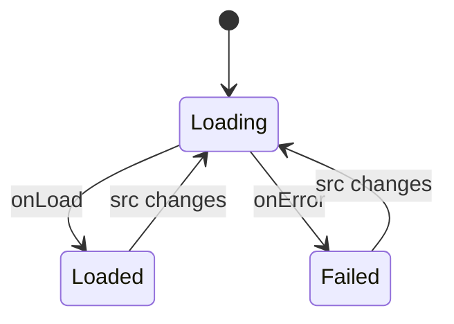
- **Risks:** two booleans allow `loaded && failed` (e.g. `onLoad` after an earlier error is impossible, but an `onError` after the effect marked loaded is not); the effect flashes `loaded=false` for a src change when the new image is cached (one frame fade-out/in). Matches `avatar.json` `fallback`.
- **Recommendation:** leave (or `status: 'idle'|'loading'|'loaded'|'failed'`). SAFE.

---

# lib

## L-01 usePresence mounted / leaving
- **State lives:** `mounted`, `leaving` useState (`lib/usePresence.js:10-11`); timer `LEAVE_MS` from `--duration-fast` (16).
- **States:** Unmounted · Mounted (open) · Leaving.
- **Transitions:** `open` true → `setMounted(true); setLeaving(false)` (13); `open` false and mounted → `setLeaving(true)`, timer → both false (14-18); cleanup clears the timer so reopening cancels the exit.
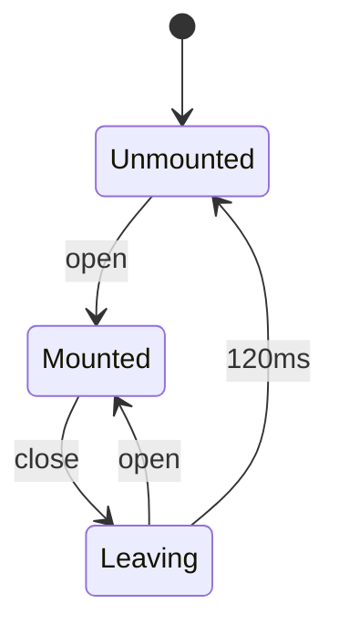
- **Risks:**
  - **One-frame gap:** the first render after `open` flips to false returns `{mounted:true, leaving:false}` with `open=false`; `data-leaving` is set only after the effect. Consumers see an "open=false, not leaving" frame (Dialog, Menu, Popover all render through it).
  - Opening: `mounted` is false on the first render after `open=true`, so content mounts one commit late (Dialog.jsx:193, Menu.jsx:321).
  - `mounted && leaving` is not distinguishable from "open && leaving" for consumers: `open && leaving` is impossible only by effect ordering, not by type.
  - Timer length is read once per close from CSS, not from the actual animation end: reduced-motion or a changed `--duration-fast` desyncs from `animationend`.
  - `useEffect` deps `[open]` with `mounted` read stale (eslint-disabled): works because `mounted` only changes through this effect.
- **Recommendation:** make explicit: derive a single `phase: 'closed'|'open'|'leaving'` and return `{mounted, leaving, phase}`; compute `leaving` synchronously (`!open && mounted`) to remove the lag frame. SAFE, but touches every popup so retest all.

## L-02 useIndicator box / ready / moving
- **State lives:** `box`, `ready`, `moving` useState; `last`, `timer` refs (`lib/useIndicator.js:18-21`); consumer data-attrs `data-indicator-ready`, `data-indicator-moving`; CSS `[data-indicator-ready] > .motion-indicator { transition }` (motion.css).
- **States:** Unmeasured (opacity 0) · Placed-unready (first paint, no animation) · Ready-still · Moving (200 ms).
- **Transitions:** layout effect measures + ResizeObserver on group and children (22-34); `box` changes after `ready` → `moving` true, timer `--duration-base` (36-43); first `box` → two rAF → `ready` (45-49).
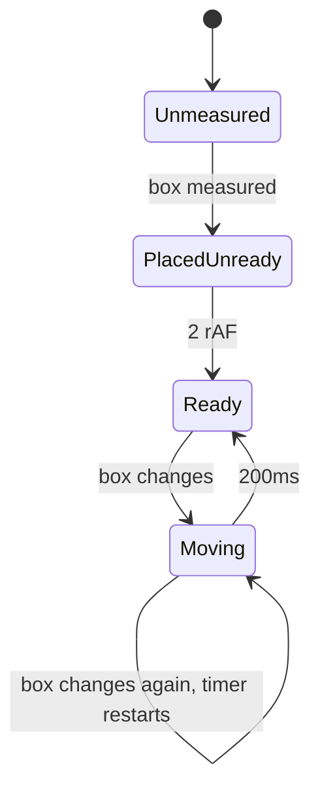
- **Risks:** `moving` also turns on for pure resizes (window resize, SideNav collapse): hover look is suppressed for 200 ms for no selection change. `ready` never resets, so an indicator that loses its target (`el` null, `box` null) and returns will slide in from its old spot (it keeps `ready`). Matches D-032.
- **Recommendation:** leave.

## L-03 LightField per-element off / on / media
- **State lives:** closure `pos`, `raf`, `reach`, `media`, `lit` Set (`lib/LightField.jsx:18-19`); per element `dataset.light` ('on'|'media'|absent), `--x/--y` style; CSS `[data-light]` (light.css).
- **States (per lit element):** Off · On · Media. Global: pointer inside / outside.
- **Transitions:** `pointermove` (non-touch) → `pos`, `media = !!target.closest('[data-media]')`, queue rAF → `paint` (30-37); `leave`/`window blur`/`documentElement pointerleave` → `pos=null` → all off (32).
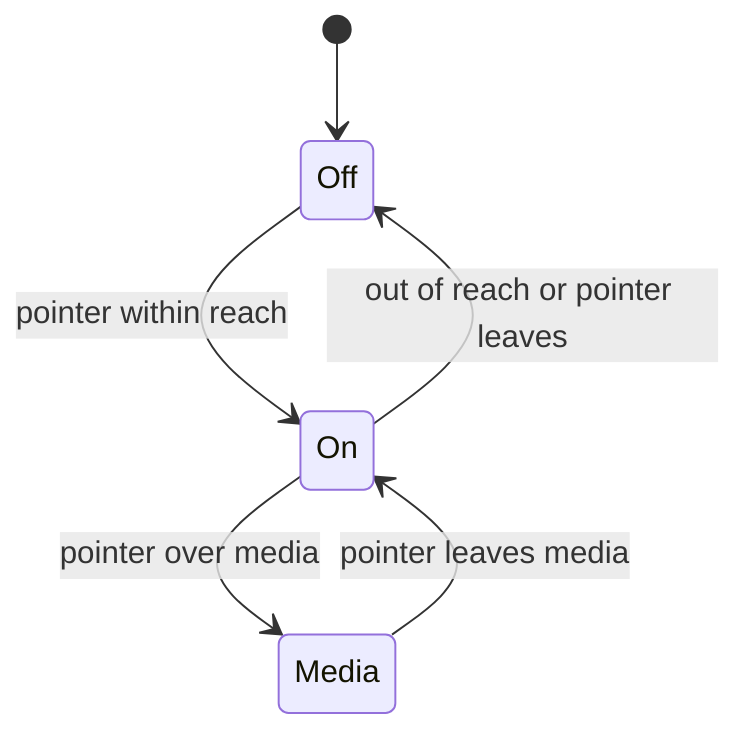
- **Risks:** `media` is sampled only from the last pointermove target; after scroll or content change under a still pointer, `media` is stale until the next move. `lit` may keep a detached element until the next paint (cleaned there). Matches D-020.
- **Recommendation:** leave.

## L-04 Token Inspector (Ctrl+Alt)
- **State lives:** closure `last`, `pos`, `on` and `tip` useState (`lib/Inspector.jsx:51-53`); `data-inspected` on the target.
- **States:** Off · Loading data (first hold) · Showing.
- **Transitions:** keydown/keyup/pointermove with `ctrlKey && altKey` → `show(x,y)` (await `load()` once, 55-70); release, blur, pointerleave → `clear`.
```mermaid
stateDiagram-v2
  [*] --> Off
  Off --> Loading: Ctrl+Alt held, first time
  Loading --> Showing: data loaded
  Off --> Showing: held, data cached
  Showing --> Off: release, blur, leave
```
- **Risks:** `on` is a single flag shared by overlapping async `show` calls: hold, release, hold again quickly resumes the first `await` with stale coordinates and a stale `on=true` (58) and paints once at the old position. Cosmetic.
- **Recommendation:** leave; add a request counter. SAFE.

---

# Docs chrome

## D-01 Docs search dialog
- **State lives:** `open`, `q`, `tokens`, `active`, `usePresence`, refs `back`, `input` (`docs/DocsChrome.jsx:49-55`); `heyoz:search` window event (21).
- **States:** Closed · Open-loading-tokens · Open-ready · Leaving.
- **Transitions:** Ctrl/⌘K toggles, `/` opens when not typing (86-95); `show` stores `back`, opens, loads tokens (78-82); `hide` closes, clears `q`/`active`, restores focus (83); overlay `pointerdown` on the backdrop hides (132); arrows/Enter/Esc/Tab handled in the input (121-127).
```mermaid
stateDiagram-v2
  [*] --> Closed
  Closed --> Open: Ctrl K, slash, event
  Open --> Leaving: Esc, pick, backdrop
  Leaving --> Closed: 120ms
  Leaving --> Open: show during fade
```
- **Risks:**
  - Own modal instead of Dialog: no scroll lock, no focus trap beyond `Tab` swallow, no `aria-modal` isolation; page behind still scrolls and receives focus on click... (the overlay covers it, so only keyboard via screen readers).
  - `show()` while already open (the `heyoz:search` event) overwrites `back.current` with the search input, which unmounts: focus is lost on close.
  - `hide` while leaving calls `back.current.focus()` again.
  - Matches D-045 only partially: D-045 calls Dialog "the one modal" and says it is based on this dialog.
- **Recommendation:** leave until Dialog migration; OWNER decision whether docs search becomes a Dialog.

## D-02 Docs copy toast + copied chip
- **State lives:** `toast {msg,on}`, `toastT` ref (`DocsChrome.jsx:54,57-61`); `el.dataset.copied` with a 900 ms timer (104).
- **States:** Hidden · Shown (1800 ms) · (chip) Copied (900 ms).
- **Risks:** a second Toast implementation (see cross-cutting #4); timers not cleared on unmount; `say` restarts the timer on each copy (fine). Not in the Toaster stack, so it can overlap real toasts.
- **Recommendation:** replace with `toast()`. OWNER (visual).

## D-03 InfoTips
- **State lives:** `tip {text,x,top,bottom,on}`, `pos`, refs `timer`, `current` (`docs/InfoTips.jsx:9-10,33`).
- **States:** Idle · Pending (150 ms) · Shown (`on`) · Fading (`on:false`, element stays mounted).
- **Transitions:** `pointerover` on `[data-info]` → `show` (150 ms timer, then set `current`); `pointerover` elsewhere → `hide` only if `current` is set (line 21); `focusin`/`focusout`; capture `scroll` hides (26).
```mermaid
stateDiagram-v2
  [*] --> Idle
  Idle --> Pending: pointerover info
  Pending --> Shown: 150ms
  Shown --> Fading: leave, blur, scroll
  Fading --> Pending: pointerover other info
  Fading --> Shown: re-enter
```
- **Risks:**
  - **Ghost tip:** while `Pending`, `current.current` is still null (set inside the timer, line 16), so `pointerover` on a non-info element does not call `hide` (line 21 requires `current.current`). Quickly sweeping across an info element shows its tooltip 150 ms later on an element the pointer already left.
  - `pos` from the previous tip is reused for one frame when the text changes (effect at 34-39 runs after paint), so a tip can flash at the old position.
  - The tip element is never unmounted after the first show (`tip` stays non-null): invisible but present, with `role="tooltip"` and stale text.
  - Violates `tooltip.json` `dismiss` (no Esc, no press dismiss, not hoverable, no touch exclusion) and D-044's "one tooltip look".
- **Recommendation:** replace with `<Tooltip>` as the spec says. OWNER; if kept, a one-line fix for the ghost: clear the timer on any `pointerover` that leaves the element. SAFE.

## D-04 Toc scroll-spy lock
- **State lives:** `active` useState, `lock` ref, IntersectionObserver `seen` Map (`docs/Toc.jsx:10-15`); `scrollend` + 120 ms debounce, 2 s fallback (`go`, 32).
- **States:** Spy (observer drives `active`) · Locked (a click holds `active` until scroll ends) · Released.
- **Transitions:** click → `lock=id`, `setActive(id)`, 2 s fallback timer; `scrollend` (or scroll events when `onscrollend` is missing) → debounce → `lock=null`.
```mermaid
stateDiagram-v2
  [*] --> Spy
  Spy --> Locked: click link
  Locked --> Spy: scrollend + 120ms
  Locked --> Spy: 2s fallback
```
- **Risks:**
  - **Listener leak:** the anonymous `scroll` listener at line 29 is never removed (cleanup removes only `scrollend`, the observer and the debounce timer) and one is added per `items` change.
  - The 2 s fallback `setTimeout` in `go` is not cleared on unmount.
  - Clicking the link of the section already at the scroll position fires no scroll, so the lock lasts the full 2 s and the marker ignores real scrolling meanwhile.
- **Recommendation:** leave the design; fix the listener leak. SAFE.

## D-05 Sidebar session + drawer
- **State lives:** `open`, `collapsed`, `ready` useState, `rail` derived (`docs/Sidebar.jsx:13-15,31`); `sessionStorage['heyoz:sidenav']`; `html[data-drawer]` set while open (23).
- **States:** Wide-expanded · Wide-collapsed (persisted) · Narrow-closed · Narrow-drawer (always expanded, Esc/scrim/route change closes).
- **Transitions:** toggle writes sessionStorage; `path` change closes the drawer (18); Esc closes (21).
- **Risks:** see C-02 (flash, `rail` flip). The drawer has no focus trap and no focus return (spec for drawers: silent); `setOpen(false)` on route change is the only path besides Esc/scrim. Matches D-033.
- **Recommendation:** leave.

## D-06 IconLibrary index loader
- **State lives:** `all`, `loaded`, `q`, `limit` useState; `loading` ref promise (`docs/IconLibrary.jsx:15-19`).
- **States:** Preview (initial subset) · Loading (fetch) · Loaded · Failed-silent.
- **Transitions:** IntersectionObserver within 1200 px or input focus → `load()` once (22-30); batch growth on scroll (32-38).
- **Risks:** on fetch failure `loading.current` is reset to null (22) but the observer already disconnected and nothing is shown: the footer says "Loading icons…" forever until the user focuses the search box.
- **Recommendation:** add `error` state and a retry. SAFE.

---

# Home screen

## H-01 Home usePopover + BrandPicker (+ ModelChip, AddMenu, CountChip)
- **State lives:** `usePopover` `open`, `ref`, `id` (`app/home/Menus.jsx:18-28`); `BrandPicker` `picked`, `ctx`, `lastCtx`, `menu = usePresence(open)`, `actions = usePresence(!!ctx && open)` (120-126); same pattern in ModelChip (192), AddMenu (214), CountChip (233).
- **States (BrandPicker):** Closed · Menu-open · Menu-open+Actions-open · Leaving.
- **Transitions:** trigger click toggles `open` and clears `ctx` (131); document `pointerdown` (bubble phase) outside trigger and `[data-owner]` → `setOpen(false)` (22-26); row click → pick brand + close; dots button → toggles `ctx` for that row (150).
```mermaid
stateDiagram-v2
  [*] --> Closed
  Closed --> Menu: trigger click
  Menu --> Actions: row dots click
  Actions --> Menu: dots click again
  Menu --> Closed: pick, outside press, trigger click
  Actions --> Closed: pick, outside press
```
- **Risks:**
  - No Esc, no arrow keys, no focus management or return (Rows are `tabIndex 0` `role="menuitem"` but the container has no key handling): fails `menu.json` `keyboard` completely. This is a screen mock, but it is built from the same menu look.
  - Outside-press listener is on bubble phase: any `stopPropagation` in the page hides it from the handler.
  - `lastCtx` is set by an effect one render after `ctx`, so `shown = ctx || lastCtx` can show the previous row's rect for one frame; during leave `shown.row` may already be detached, so the actions menu `rect()` jumps to (0,0).
  - `BrandPicker` and `HomeSideNav` do not coordinate: toggling the nav (Ctrl+B) while the menu is open leaves the menu placed against the old trigger rect until the next scroll/resize.
  - Four separate copies of `usePopover` instances; `open` can be true in two chips at once? No: each outside press closes the others (the press is outside them), so single-open holds by accident.
- **Recommendation:** replace with `Menu`/`Popover` components (D-043 says Home's menu became Menu). OWNER (Home is a reference screen).

## H-02 Home Menu placement (root / pos)
- **State lives:** `pos`, `root` useState (`Menus.jsx:44-45`), measured in a layout effect with `anchor`, `rect` (46-67).
- **States:** No-root (renders null) · Measuring (`visibility:hidden`) · Placed.
- **Risks:** a third and fourth copy of placement (`Menu.jsx place()`, `floating.js place()`); `root !== host` forces a state round-trip (49); `setPos` on every scroll without rAF throttling (65).
- **Recommendation:** merge with `floating.js`. SAFE once H-01 is decided.

---

# Editor

All editor state is one module object `S` in `app/editor/store.js:11-17`, mutated by actions, with two change signals (`S.v` via `bump`, `S.t` via `emit`).

## E-01 Editor layer flags (sel / sheet / pop / ai / narrow) + Esc chain
- **State lives:** `S.sel`, `S.sheet` (null|'panel'|'insp'), `S.tab`, `S.pop`, `S.ai`, `S.narrow` (`store.js:12-16`); transitions `select` (66), `openTab` (67-70), `closeSheet` (71), `openPop`/`closePop` (73-79), `openAI` (146-156), `aiGo` (163), `restore` (42); Editor.jsx:28 (narrow resize), :37 (`sheetOpen`), :137 (Esc precedence).
- **States (effective):** Idle · Selected · Panel-open · Selected+Insp-sheet (narrow) · Popover-open (9 types) · AI-popover · Selected+Popover… i.e. the cross product of five flags, not a table.
- **Transitions:**
  - `select(id)` clears `pop` and `ai`, closes the insp sheet when deselecting.
  - `openTab` toggles the panel and clears `pop`.
  - `openPop` replaces `pop` (toggle if same type) but **does not touch `ai`, `sheet` or `sel`**.
  - Esc: pop → sheet → sel (one level per press).
  - Narrow-breakpoint crossing: `sheet = null; pop = null` (Editor.jsx:28) but not `ai`.
```mermaid
stateDiagram-v2
  [*] --> Idle
  Idle --> Selected: select clip
  Selected --> Idle: Done or Esc
  Idle --> Panel: openTab
  Panel --> Idle: openTab same, Esc, scrim
  Selected --> Popover: right click, menu
  Idle --> Popover: top bar button
  Popover --> Idle: Esc, scrim, pick
  Popover --> Selected: Esc when sel
  Selected --> InspSheet: narrow Edit button
  InspSheet --> Selected: Esc, close
```
- **Risks:**
  - **Orphan `S.ai`:** `openPop('export' | 'ratio' | 'account' ...)` while the AI popover is open replaces `S.pop` but leaves `S.ai` set (store.js:73-78). Nothing renders it until `S.pop.type==='ai'`, but `openAI` and `aiGo` read it, and Esc/`closePop` clear it. Also Editor.jsx:28 clears `pop` and `sheet` on breakpoint change but not `ai`.
  - `S.sheet='insp'` is set directly from the action bar (`Editor.jsx:113`, `S.sheet = 'insp'; bump()`), bypassing store actions.
  - `S.sheet` can be 'insp' on desktop (after `addText`: `S.sheet = S.narrow ? 'insp' : null`) only via narrow; after resize narrow→wide it is cleared (28): fine.
  - Keys behind an open popover: `onKey` only blocks when `S.pop?.type === 'cmd'` or typing (Editor.jsx:138). With export/ratio/ai/keys popovers open, Space plays, `S` splits, Delete deletes the selected clip behind the popover.
  - Esc is handled before the typing check (137): Esc in the project-name input deselects the clip or closes a sheet.
  - Popovers and panels unmount instantly (no `usePresence`): no leave fade, against D-031.
- **Recommendation:** make explicit: one `layer: {kind, ...}` (none | panel | insp | pop) beside `sel`, so `pop`, `ai`, `sheet` cannot disagree. SAFE (mechanical) but wide; add the "block global keys while a popover is open" rule: OWNER.

## E-02 Editor popover (S.pop)
- **State lives:** `S.pop = {type, rect, mode, data, fresh}` (`store.js:77`); types: ratio, export, more, account, keys, ctx, ai, cmd (Popovers.jsx:41-130). `fresh` consumed in a layout effect (Popovers.jsx:35). Placement in `place()` (17-24) and `S.narrow` sheet mode (38).
- **States:** Closed · each of 8 types · (sheet variant when narrow, except ratio/account/more).
- **Transitions:** `openPop(type)` toggles when the same type is already open (and `!data.keep`, line 74); `closePop()`; scrim/`ed-catch` click closes (134); Esc (global).
```mermaid
stateDiagram-v2
  [*] --> Closed
  Closed --> Open: openPop
  Open --> Closed: same type again
  Open --> Open: other type replaces
  Open --> Closed: Esc, scrim, action
```
- **Risks:**
  - `openPop('ctx', ...)` for a second clip while one context menu is open **closes** it instead of re-anchoring (the toggle rule, line 74); the `ed-catch` layer normally intercepts first, but the Inspector header button (Inspector.jsx:32) hits the same rule.
  - Render has side effects: `S.pop = null; return null` when the AI clip is gone (Popovers.jsx:95) and `P.fresh = false` in an effect (35); neither bumps.
  - `sheet` is read in the layout-effect closure before its `const` declaration (34 vs 38): safe only because the effect returns early when `P` is null.
  - No focus trap or return focus (focus moves in via `data-autofocus` once, never back).
- **Recommendation:** make explicit with E-01; add presence for the leave fade. SAFE.

## E-03 AI flow (S.ai)
- **State lives:** `S.ai = {clipId, action, model, modelOpen, prompt, by}` (`store.js:154`), consumed in Popovers.jsx:94-128; `aiGo` (158-167); `lastAI` array (50).
- **States:** None · Configuring(action: regenerate | extend | edit) x (model capable | blocked) x (model list open | closed) · Running (job on the clip, popover closed) · Done.
- **Transitions:** `openAI(action)` picks a capable model (146-156); tab buttons switch action (blocked ones toast via `aiBlocked`); `pick(model)` updates `by` cap; `aiGo` validates (`support`, edit needs prompt), clears `pop`/`ai`, `checkpoint()`, pushes `lastAI`, starts `runJob`.
```mermaid
stateDiagram-v2
  [*] --> None
  None --> Configuring: openAI
  Configuring --> Configuring: tab, pick model, edit prompt
  Configuring --> Running: aiGo
  Configuring --> None: Esc, Cancel, select, restore
  Running --> Done: job 100 percent, applyAI
  Running --> None: undo, clip deleted
```
- **Risks:**
  - Parallel to `S.pop` (see E-01): `S.ai` can exist with a different `S.pop`, or `S.pop.type==='ai'` with `S.ai===null` (handled by the render-time reset at Popovers.jsx:95).
  - `aiGo` does not check `c.meta.status === 'generating'` (only `canDo` does, in menus): a job started for a clip already generating from `genAudio` or another AI job, via the popover opened earlier, starts a second interval on the same clip; both write `progress` and the first to reach 1 deletes `status`, so the second stops silently and its `apply` never runs.
  - `Undo` toast closure `undo` is not bound to this step (see E-11).
- **Recommendation:** make explicit as `S.pop.data` of type 'ai' plus a `job` entry per clip. SAFE.

## E-04 Generation jobs + captions pending
- **State lives:** `clip.meta.status` ('generating'|absent) and `clip.meta.progress` (`store.js:121`); `runJob` interval 120 ms (122-127); `capTO` timeout for captions (108-118). No "pending" in `S` for captions.
- **States (per clip):** Idle · Generating(progress 0..1) · Done. Captions: Idle · Pending (1.2 s timer) · Added.
- **Transitions:** `runJob` sets status; interval stops when the clip is missing or status is no longer 'generating' (undo/restore removes it, `restore` line 41); at progress 1: delete status/progress, `apply`, `relayout`, `markSaved`. `captions()` toasts then `setTimeout` pushes clips.
```mermaid
stateDiagram-v2
  [*] --> Idle
  Idle --> Generating: runJob
  Generating --> Done: progress 1, apply
  Generating --> Idle: undo, delete, restore
  Done --> Idle: next frame
```
- **Risks:**
  - Job state lives in the document (`clip.meta`) and therefore in undo snapshots (`snap()` serialises it, store.js:36). Undo during a job, then redo: the redo snapshot (taken at undo time) holds `status: 'generating'`, `restore()` strips it (41) and the job never resumes and `applyAI` never runs (the clip looks finished without its result).
  - Captions: not cancellable and not reflected in `S`; Undo, `scene()`, or a second project change within 1.2 s still pushes captions into whatever project is current at that moment, with a `checkpoint()` at that later time.
  - Intervals are not tracked; a `scene()` call during a job leaves the interval running against the new project until it finds no clip.
  - `genAudio` toast text says "Generating…" while the first interval tick is 120 ms later.
- **Recommendation:** make explicit: a `jobs` map outside the document with explicit cancel on scene/undo; captions as a job. SAFE for the structure; the redo behaviour is OWNER.

## E-05 Export run / done
- **State lives:** `S.exp = {res, p, run, done}` created lazily (`Popovers.jsx:46`); `setInterval` inside `go()` (49); `openPop('export')` resets `S.exp = null` (store.js:75).
- **States:** Idle · Running(p 0..1) · Done.
- **Transitions:** Export button → `run=true`, interval 150 ms; tick adds 0.08; at 1: `run=false, done=true`; if the export popover is no longer `S.pop`, the next tick clears the interval but leaves `run=true`.
```mermaid
stateDiagram-v2
  [*] --> Idle
  Idle --> Running: Export video
  Running --> Done: p reaches 1
  Running --> Idle: popover closed, exp reset on reopen
  Done --> Idle: reopen resets
```
- **Risks:**
  - The interval belongs to a closure over the old `E` object. Close and reopen the export popover within 150 ms: `S.exp` is reset to a new object, but the old interval keeps ticking its orphan `E`, fires a phantom `export_completed` event, and then stops (condition at 49 is true for the reopened popover so it also keeps bumping).
  - `run`/`done` are two booleans (both false, one true by convention); an interrupted export loses state silently, with no "Cancel".
  - Render-time `S.exp ||= {...}` mutation (46).
  - Segmented `off` array blocks both options while running (55), which is correct.
- **Recommendation:** make explicit (`phase`) and own the interval in the store with cancel. SAFE.

## E-06 Undo / redo history
- **State lives:** `hist.u`, `hist.r` stacks of JSON snapshots, cap 80 (`store.js:18,37`); `lastAI` depths (50); `restore()` (38-43).
- **States:** Empty · Undoable · Redoable · Both.
- **Transitions:** `checkpoint()` pushes and clears redo; `undo()`/`redo()` swap stacks and call `restore()`; `scene()` clears all (188).
```mermaid
stateDiagram-v2
  [*] --> Empty
  Empty --> Undoable: checkpoint
  Undoable --> Redoable: undo
  Redoable --> Undoable: redo
  Redoable --> Undoable: new checkpoint clears redo
```
- **Risks:**
  - `lastAI` stores history depths; once `hist.u.length` hits the 80 cap (`shift`), depths no longer line up and `ai_action_undone` is misreported. Redo of an AI step re-pushes history but not `lastAI`, so a second undo is not tracked (analytics only).
  - Mid-job undo/redo (E-04).
  - `restore()` resets `pop` and `ai` but not `sheet`, `drag`, `playing`; an undo during a timeline drag swaps the project under `S.drag` (the drag looks up the clip by id and may act on the restored one).
  - Snapshot is the whole project plus selection: no coalescing beyond the `armed` flags (E-07).
- **Recommendation:** leave the stack; fix the interactions with E-04/E-07. OWNER (what undo means for a running job).

## E-07 Edit coalescing (`armed`, two copies)
- **State lives:** module `let armed` in `Inspector.jsx:13` (edits) and a separate `armed` in `Editor.jsx:56` (project rename); sliders call `onCommit` on `pointerup`/`keyup` (parts.jsx:26).
- **States:** Armed (next edit checkpoints) · Disarmed (inside a continuous change).
- **Transitions:** `edit(c,k,v,done)` checkpoints when armed then disarms; `done` or `commitEdit` re-arms (Inspector.jsx:14-15); rename re-arms on focus (Editor.jsx:66).
```mermaid
stateDiagram-v2
  [*] --> Armed
  Armed --> Disarmed: first edit, checkpoint
  Disarmed --> Armed: slider commit, done flag
  Disarmed --> Disarmed: more edits, no checkpoint
```
- **Risks:**
  - **Not keyed by clip or property.** The flag is global: edit clip A's slider without a commit (touch cancel, pointer released outside the thumb because only `onPointerUp` on the input is listened to), then edit anything else with `edit(...)`: it joins A's undo step; one Undo reverts both.
  - **Text content never re-arms.** `TextArea` calls `edit(c,'props.text',v)` without `done` (Inspector.jsx:110) and has no commit: after typing, the next slider drag is not checkpointed at its start and merges into the text-typing step (until a commit on that slider).
  - **NumberField checkpoints every keystroke.** It passes `done=true` (99, 127, 140), so every digit is its own undo step, contradicting the comment on line 12 ("one undo step per ... typing in a field").
  - **Undo does not re-arm.** After `undo()`, `armed` can be false; the next edit applies without a checkpoint, so it cannot be undone separately and may overwrite redo.
  - Two copies (`Inspector.jsx` and `Editor.jsx`) of the same idea.
- **Recommendation:** replace with one coalescer `coalesce(key)` that checkpoints when the key (`clipId:prop`) changes or after a quiet period, reset by undo/redo/select. SAFE (mechanical) with a decision on the undo granularity: OWNER for NumberField.

## E-08 Playback
- **State lives:** `S.playing`, `S.rate`, `S.t`, module `last` (`store.js:12,176`); rAF loop in Editor.jsx:30; `play`, `stop`, `jog`, `tick`.
- **States:** Stopped · Playing forward (rate 1, 2, 4) · Playing reverse (rate −1, −2, −4).
- **Transitions:** Space/button `play()` toggles; `J`/`L` → `jog(dir)` (start or double speed or flip direction); `K`, arrows, scrub → `stop()`; `tick` stops at ends (180); `play()` at end rewinds (172).
```mermaid
stateDiagram-v2
  [*] --> Stopped
  Stopped --> Forward: play, L
  Stopped --> Reverse: J
  Forward --> Forward: L doubles up to 4x
  Reverse --> Reverse: J doubles up to 4x
  Forward --> Reverse: J
  Reverse --> Forward: L
  Forward --> Stopped: K, Space, end, arrow
  Reverse --> Stopped: K, Space, start, arrow
```
- **Risks:**
  - **Stuck negative rate.** `jog(-1)` from stopped sets `S.rate = -1` then `play()` (175); if the project is empty (`total` 0) `play()` returns early (171) and nothing resets the rate (`stop()` returns at once when `!S.playing`, line 174). Later Space plays **backwards** (and from `t<=0` jumps to the end).
  - `jog` while the project is empty also bumps with rate shown in the UI only when `playing` (Editor.jsx:93), so the bad state is invisible.
  - `stop()` from `tick` end-of-range resets `rate=1`: good; `scene()` calls `stop()` but if not playing the rate is not reset (188).
  - `tick` clamps `dt` to 0.1 s (179): a hidden tab then jumps at most 0.1 s: correct.
  - Playing while a drag/trim edits the project is allowed (no state links drag to playback; only the ruler scrub stops it, Timeline.jsx:77).
- **Recommendation:** make explicit `{mode: 'stopped'|'play', rate}` with `rate` reset on every transition to stopped. SAFE.

## E-09 Timeline drag + zoom/autofit
- **State lives:** `S.drag` `{type:'scrub'|'trim'|'move', side, id, x0, orig, moved, cp}` (`Timeline.jsx:77,85`); `S.autofit`, `S.pps` (15-21, 59); module `el.scroll`.
- **States:** Idle · Scrubbing · Pending-drag (pressed, < 3 px) · Trimming · Moving · (autofit on/off).
- **Transitions:** pointerdown on ruler → scrub (stops playback); on a clip → select (+ playhead into the clip) then `drag` unless the clip is generating (83); move ≥ 3 px → `moved`, one `checkpoint()` (93), mutates the clip; `pointerup` → `markSaved` + analytics; `pointercancel` → `S.drag = null` only (115).
```mermaid
stateDiagram-v2
  [*] --> Idle
  Idle --> Scrub: down on ruler
  Scrub --> Idle: up
  Idle --> Pressed: down on clip
  Pressed --> Moving: moved 3px, move
  Pressed --> Trimming: moved 3px, handle
  Moving --> Idle: up
  Trimming --> Idle: up
  Pressed --> Idle: up, no move
  Moving --> Idle: cancel
```
- **Risks:**
  - `pointercancel` clears `S.drag` without `markSaved`, analytics, or a `bump`: the clip was already mutated and checkpointed, but the UI is not refreshed and the saved indicator is not updated.
  - No cancel by Esc: Esc in `onKey` closes pop/sheet/selection, not the drag (Editor.jsx:137), and there is no revert.
  - Undo (⌘Z) during a drag swaps the project under `S.drag` (E-06).
  - `lostpointercapture` is not handled; a second pointer down while `S.drag` exists replaces it.
  - `autofit && !S.drag` recomputes `S.pps` during render (Timeline.jsx:59): render mutates store.
  - Keyboard `[` `]` trim does its own `checkpoint()` per keypress (38), not coalesced.
- **Recommendation:** make explicit (drag as a small reducer with `cancel`); share the drag shell with Preview (E-10). SAFE.

## E-10 Preview text drag + fit
- **State lives:** `drag` ref `{id, cp}` (`Preview.jsx:66`); `box` useState (46); `ed-cvbox[data-sel]`.
- **States:** Idle · Dragging text (checkpoint on first move).
- **Risks:** no `pointercancel` handler (only `onPointerUp`, line 82): a cancelled gesture leaves `drag.current` set, so a later pointer move without a press keeps dragging the text. This is a second drag machine next to `S.drag`, so scrubbing and text dragging are not mutually exclusive in the store.
- **Recommendation:** merge into the timeline drag reducer. SAFE.

## E-11 Editor toast (single slot)
- **State lives:** `S.toast = {msg, label, fn, id}` and module `toastTO` (`store.js:56-62`); rendered by `Editor.jsx:122`.
- **States:** None · Showing (2.4 s, or 4.5 s with an action) · Replaced.
- **Transitions:** `toast()` overwrites the slot and restarts the timer; `toastAct` runs `fn` and clears; timer clears.
```mermaid
stateDiagram-v2
  [*] --> None
  None --> Showing: toast
  Showing --> Showing: new toast replaces
  Showing --> None: timer or action
```
- **Risks:**
  - **Stale Undo.** `del()` shows "Deleted · Undo" bound to `undo` (store.js:96), which pops the *latest* history step, not the delete. Within 4.5 s, an edit that makes no toast (split, trim, inspector change) leaves the toast visible, and "Undo" then undoes that later edit, not the delete. The same for the captions and AI toasts (116, 165).
  - A newer toast without an action silently drops an earlier action toast: the user loses the Undo.
  - One slot, no stack, no pause on hover/focus, no `role="alert"` variant: contradicts `toast.json` `time`/`stack`/`live`. D-034 marks it a draft.
- **Recommendation:** bind the action to a specific history depth (undo only if the top is still that step) and replace with the shared Toast. OWNER.

## E-12 Saved indicator
- **State lives:** `S.saved` ('saved'|'saving'), `saveTO` (`store.js:52-53`); shown in `Editor.jsx:68`.
- **States:** Saved · Saving (700 ms debounce).
- **Risks:** purely cosmetic (no persistence); `commit()` bumps before the timer, so there is no failure state. Rename calls `markSaved` per keystroke (fine).
- **Recommendation:** leave.

## E-13 Mount, scenes, ready fade
- **State lives:** `scene(name)` resets a subset of `S` (`store.js:187-196`); Editor mount effect (`Editor.jsx:25-34`); `data-ready` set after two rAF; `S.narrow` via ResizeObserver.
- **States:** Mounting (hidden) · Ready (fade-in) ; scenes none/clip/text/ai/empty/grown.
- **Risks:** `scene()` does not reset `S.rate`, `S.gc`, `S.ga`, `S.safe`, `S.narrow`, `S.drag`, `S.saved`, intervals (E-04) or `capTO`; a scene change within 1.2 s of a captions request adds captions to the new project. The store is a module singleton: navigating away and back re-runs `scene()` (fine) but intervals from the previous visit survive.
- **Recommendation:** leave; add a `reset()` that cancels timers. SAFE.

## E-14 Command palette (cmd)
- **State lives:** `S.pop.data {q, i}` (`store.js:76`), `Cmd` in `Popovers.jsx:147-180`.
- **States:** Closed · Open(query, index).
- **Risks:** index `i` is clamped on render but not stored clamped; after a filter shrinks the list `P.data.i` can exceed the list length until the next arrow press (render uses the clamp, Enter uses the clamped item: OK). Ctrl+K opens even while typing in an input (Editor.jsx:136). Matches the spec-less draft.
- **Recommendation:** leave.

---

# Top risks (ordered)

1. **E-07 `armed` coalescing is global and unkeyed** (`app/editor/Inspector.jsx:12-16`, `110`, `99`; `app/editor/Editor.jsx:56`). Wrong undo grouping; undo does not re-arm; NumberField checkpoints per keystroke.
2. **E-11 stale Undo toast** (`app/editor/store.js:56-62`, `96`). "Undo" can revert a different edit than the one the toast names.
3. **E-01/E-03 layer flags disagree** (`app/editor/store.js:73-78`, `app/editor/Editor.jsx:28`, `137-138`, `app/editor/Popovers.jsx:95`). `S.ai` orphaned by `openPop` and by the narrow-breakpoint reset; global keys keep working behind open popovers.
4. **E-08 stuck reverse rate** (`app/editor/store.js:170-175`). `jog(-1)` on an empty project leaves `S.rate=-1`; the next Space plays backwards.
5. **C-06/C-14 reopen during leave reuses stale subtree** (`components/Menu.jsx:227-231`, `components/Dialog.jsx:132-140`, `lib/usePresence.js:12-19`). Mount-only `autoFocus`/`opener` effects do not re-run; AlertDialog Esc cancels while `loading` (`components/Dialog.jsx:205`).

Next tier: InfoTips ghost tip (`docs/InfoTips.jsx:12-21`), Toc scroll-listener leak (`docs/Toc.jsx:29`), Toaster `focus` can stick and freeze all timers (`components/Toast.jsx:173-174`), export interval after reopen (`app/editor/Popovers.jsx:49`), `pointercancel` in Timeline/Preview (`app/editor/Timeline.jsx:115`, `app/editor/Preview.jsx:82`), Chip remove timer (`components/Chip.jsx:44`).

# Recommended order of work

1. **SAFE, small:** E-08 rate reset; D-04 listener leak; C-21 chip timer; E-10/E-09 pointercancel; D-06 error state; C-03 refocus flag.
2. **SAFE, medium:** L-01 `phase` + synchronous `leaving`; C-06/C-14 remount per open; E-07 keyed coalescer; E-01/E-02/E-03 single `layer` field.
3. **OWNER:** migrate SideNav tips and InfoTips to Tooltip (C-04, D-03); Home menus to Menu (H-01); editor toast to Toast (E-11); Dialog Esc while loading (C-14); redo of a running job (E-06).
